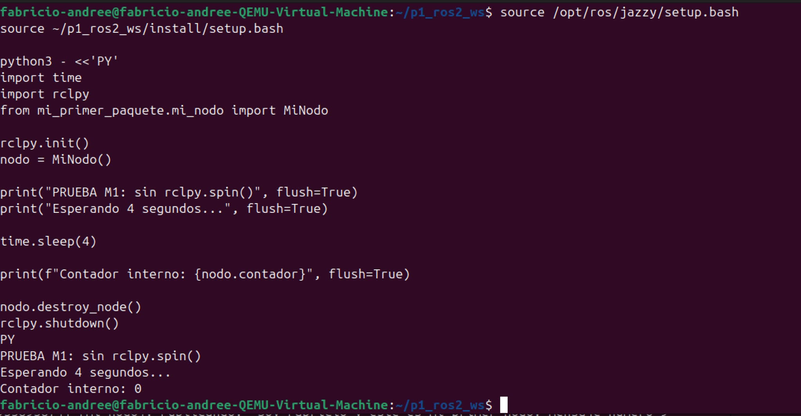
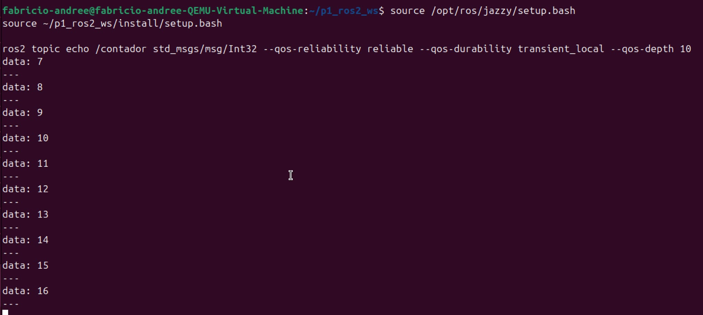
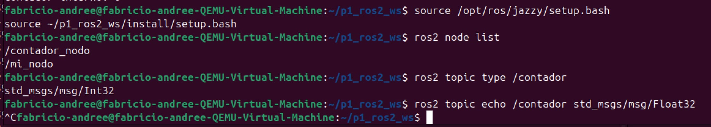
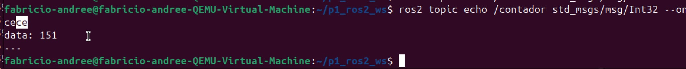
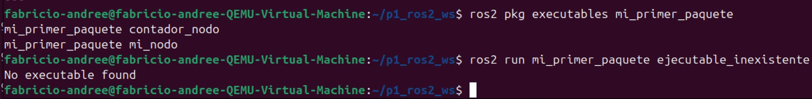

# P1 Individual Evaluable — Memoria conceptual

**Asignatura:** Arquitecturas Software para Robótica · Tema 1  
**Estudiante:** Fabricio Andree Rodriguez  
**Profesor:** Julio Merelo Casado  
**Universidad:** Universidad Camilo José Cela (UCJC)  
**Entorno:** Ubuntu 24.04 (ARM64, máquina virtual UTM) · ROS 2 Jazzy · Python 3.12.3

Las pruebas que cito las ejecuté en ese entorno. Las capturas están en `evidencias/capturas/` y se identifican por su nombre de archivo.

## M1. ¿Qué ocurre exactamente si quito `rclpy.spin()` de `main()`? ¿Por qué?

El programa arranca, crea el nodo y termina casi de inmediato sin publicar ningún saludo. Sin `spin()`, `main()` ejecuta `rclpy.init()`, construye `MiNodo` (con su publicador y su temporizador) y pasa directamente al bloque `finally`, que destruye el nodo y cierra ROS 2.

La razón es que crear un temporizador, una suscripción o un servicio solo registra un *callback*. Quien lo ejecuta es un ejecutor, que espera a que haya eventos listos y llama a la función correspondiente. `rclpy.spin()` mantiene ese ejecutor en marcha; sin él, nadie atiende el temporizador.

Para comprobar que no se trata solo de que el proceso acabe pronto, hice una prueba aparte sin modificar el paquete. Creé un `MiNodo`, mantuve vivo el proceso con `time.sleep(4)` y consulté su contador interno. El resultado fue `Contador interno: 0` (Figura 1). Aunque pasaron cuatro segundos, con el temporizador configurado a 1 Hz, el *callback* no se ejecutó ninguna vez. Esperar no equivale a procesar eventos.

## M2. ¿Qué significa el 10 de `create_publisher(..., 10)` y qué política QoS formaliza ese concepto?

El 10 es la **profundidad del historial**: cuántos mensajes como máximo se guardan en la cola de esa entidad. No son diez segundos ni diez suscriptores. Pasar un entero a `create_publisher` equivale a un `QoSProfile(depth=10)`. Lo formaliza la política **History** en modo **KEEP_LAST**: se conservan las 10 muestras más recientes y, si llega una más, se descarta la más antigua.

El resto de políticas toma su valor por defecto. En `mi_nodo` eso significa `RELIABLE` y durabilidad `VOLATILE`, de modo que un suscriptor que se conecta tarde a `/saludo` no recibe nada de lo publicado antes. En `/contador` configuré explícitamente `RELIABLE`, `TRANSIENT_LOCAL` y profundidad 10.

`ros2 topic info /contador --verbose` confirma la fiabilidad y la durabilidad, pero muestra `History (Depth): UNKNOWN`, porque el descubrimiento no propaga ese dato. Por eso comprobé la profundidad con un experimento. Detuve `mi_nodo` tras el saludo 15, con el total en 16, y conecté después un `ros2 topic echo` con QoS compatible. Recibí exactamente los valores 7 a 16: diez mensajes, la profundidad configurada, incluido el último total (Figura 2).

## M3. Si otro nodo se suscribe a `/contador` esperando `Float32`, ¿qué ocurre y cómo lo diagnosticaría?

El suscriptor no recibe ningún mensaje y tampoco se produce un fallo evidente: el nodo sigue en marcha, simplemente sin datos. En DDS, un publicador y un suscriptor solo se emparejan si coinciden el nombre del tópico **y** el tipo. `/contador` transporta `std_msgs/msg/Int32`, así que un suscriptor de `std_msgs/msg/Float32` nunca se conecta con él.

Lo reproduje así. `ros2 topic type /contador` devolvió `std_msgs/msg/Int32`, y `ros2 topic echo /contador std_msgs/msg/Float32` no mostró ningún dato durante la observación (Figura 3). Con el tipo correcto, `Int32`, recibí `data: 151` (Figura 4).

Para diagnosticarlo comprobaría primero que el nodo existe y que el tópico aparece (`ros2 node list`, `ros2 topic list`). Después compararía el tipo que declara cada extremo con `ros2 topic type`, `ros2 topic list -t` o `ros2 topic info /contador --verbose`, que lista cada publicador y suscriptor con su tipo y su QoS. La solución es que ambos usen el mismo tipo, o convertir el valor en un nodo intermedio.

## M4. ¿Cómo distingo el error `No executable found` de un problema de comunicación por tópicos?

Por el momento en que aparece. `No executable found` lo devuelve `ros2 run` **antes** de lanzar ningún proceso: el paquete existe, pero no encuentra un ejecutable con ese nombre entre los instalados. Lo reproduje con `ros2 run mi_primer_paquete ejecutable_inexistente`, mientras `ros2 pkg executables` listaba mis dos ejecutables reales (Figura 5).

Las causas habituales son un nombre mal escrito, un `entry_point` ausente en `setup.py`, no haber recompilado con `colcon build` o no haber hecho `source install/setup.bash` en esa terminal. Si fallara el nombre del paquete, el error sería otro: `Package not found`.

En un problema de comunicación, en cambio, los procesos arrancan y los nodos aparecen en `ros2 node list`, pero los datos no llegan. Ahí revisaría `ros2 topic list` e `info --verbose`: nombres de tópico, número de publicadores y suscriptores, tipos y compatibilidad QoS. También comprobaría que todos los nodos comparten `ROS_DOMAIN_ID`.

En resumen: si no hay proceso, el problema es de construcción o de entorno; si hay procesos pero no hay datos, es de comunicación.
